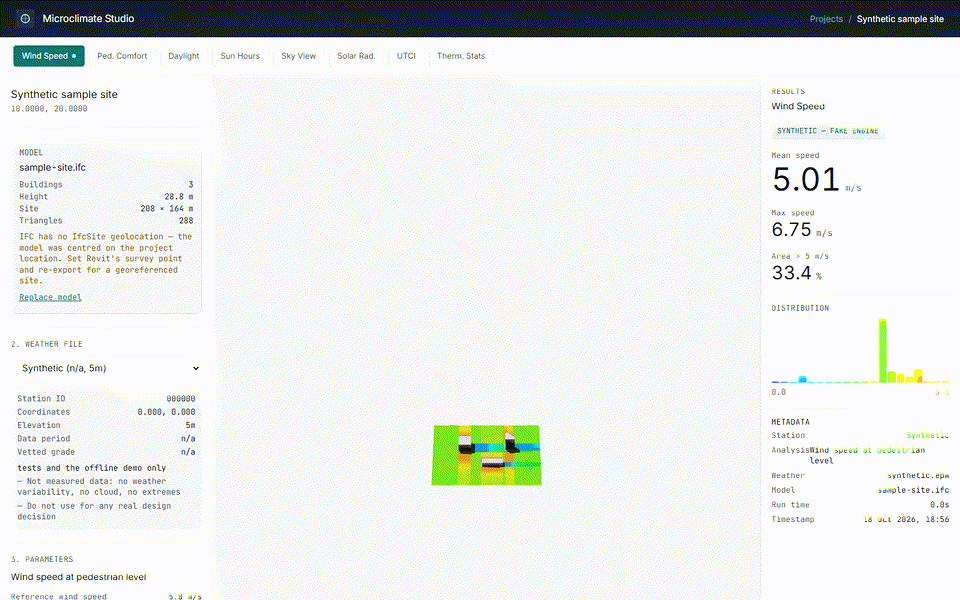
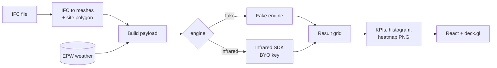

# Microclimate Studio

Upload an IFC model, run any of eight microclimate analyses on it, and read the results as heatmaps, KPIs and histograms, without writing SDK code.



*Synthetic: the fake engine on a generated three-building sample site. Not measured data and not physics.*

Built on the [Infrared City Python SDK](https://pypi.org/project/infrared-sdk/) (Apache-2.0). Not affiliated with Infrared City GmbH.

## Quickstart

Needs Python 3.11+ (3.11 and 3.12 are what CI runs), [uv](https://docs.astral.sh/uv/) and, for the UI, Node 20+.

### Zero-key path (fake engine, no network)

PowerShell:

```powershell
uv venv --python 3.11 .venv
uv pip install -r backend/requirements-dev.txt
.venv\Scripts\python backend/demo.py --out out/demo
.venv\Scripts\python -m pytest -q
```

bash:

```bash
uv venv --python 3.11 .venv
uv pip install -r backend/requirements-dev.txt
.venv/bin/python backend/demo.py --out out/demo      # .venv/Scripts/python on Git Bash for Windows
.venv/bin/python -m pytest -q
```

`demo.py` creates a project, uploads `examples/sample-site.ifc`, selects the generated `synthetic` weather file, runs all
8 analyses on the fake engine and writes `out/demo/<analysis>.png` plus `out/demo/summary.json`. It takes a few seconds on a
typical laptop.

### The web UI

Backend, in one terminal (use another `--port` if 8000 is taken, and set `VITE_API_BASE_URL` to match):

```bash
cd backend
../.venv/Scripts/python -m uvicorn main:app --port 8000     # ../.venv/bin/python on Linux/macOS
```

Frontend, in a second terminal:

```bash
cd frontend
npm ci
npm run dev        # http://localhost:5173
```

In the UI: New Project, drop in `examples/sample-site.ifc`, pick an analysis tab, Run Analysis. `npm run build` is the
production build. With the backend down, the frontend falls back to client-side demo data and says so.

### Live path (your own Infrared key)

The key is bring-your-own. Copy `.env.example` to `.env` and fill in one variable:

```
INFRARED_API_KEY=
```

With a key set, the engine defaults to `infrared`. Runs are billed by Infrared according to your account. Force one or
the other with `MCS_ENGINE=fake` or `MCS_ENGINE=infrared`. The live path is not exercised by the tests (the single
network call, `dispatch.run`, is stubbed) and was not run for this edition.

```bash
MCS_ENGINE=infrared .venv/bin/python backend/demo.py --out out/live
```

### Real weather files (optional, needs network)

```bash
python scripts/fetch_weather.py --all        # or one id, e.g. dubai_ae
```

Downloads each EPW from its `source_url`, verifies the SHA-256 from the manifest, and writes it to `weather_data/`
(git-ignored). A checksum mismatch writes nothing and exits non-zero.

## What it does



- Reads an IFC export with IfcOpenShell, one mesh per `IfcBuilding`, and derives a site polygon (building extent plus 50 m).
- Runs the 8 Infrared analyses below. Each UI control maps to a field of the SDK request payload.
- Filters an EPW by month, day and hour window before sending it. The weather library records where each file came from.
- Turns the result grid into KPIs, a 20-bin histogram and a heatmap PNG. Cells outside the site are `NaN`, not zero.
- Shows buildings as extruded storey footprints on a deck.gl scene, with the heatmap draped on the ground.
- Switches between the real engine and a fake engine with `MCS_ENGINE`. Every result carries an `engine` field and the UI shows a badge when it is `fake`.
- Keeps projects as flat files under `backend/cache/`. No database.
- Single-tile sites only (up to 512 m); a larger site produces a warning at upload.

### The 8 analyses

| Analysis (`id`) | Main inputs | Output (unit) | Needs weather |
|---|---|---|---|
| Wind speed (`wind-speed`) | reference speed, direction | speed at pedestrian level (m/s) | no |
| Pedestrian wind comfort (`pedestrian-wind-comfort`) | criterion (Lawson, VDI, Davenport, NEN 8100), time window | comfort class per cell | yes |
| Daylight availability (`daylight-availability`) | time window | hours of daylight (h) | no |
| Direct sun hours (`direct-sun-hours`) | time window | un-occluded sun hours (h) | no |
| Sky view factors (`sky-view-factors`) | none | visible sky share (%) | no |
| Solar radiation (`solar-radiation`) | time window | cumulative irradiance (kWh/m²) | yes |
| UTCI (`thermal-comfort-index`) | time window | felt temperature (°C) | yes |
| Thermal comfort statistics (`thermal-comfort-statistics`) | band (comfort, heat stress, cold stress), time window | hours in band (h) | yes |

The time window is one month, a day range and an hour range. The source of truth is `backend/catalog.py`.

### Weather library

Five public TMYx reference stations are listed in `weather_data/weather_manifest.yaml`, plus a generated `synthetic` entry. The real
files are fetched, not shipped. Provenance chain:

```
NCEI ISD / ERA5 -> Climate.OneBuilding.org TMYx file -> manifest (source_url, period, quality score, limitations, sha256)
  -> scripts/fetch_weather.py (verifies sha256) -> backend/weather.py (time-window filter) -> engine
```

Details, the quality rubric and station limitations: [docs/weather-library.md](docs/weather-library.md).

### Coordinate frames

Site metres (X east, Y north, origin at the south-west corner of the site polygon's bounding box) for meshes; GeoJSON
`[longitude, latitude]` for the polygon, scene and heatmap. See [docs/coordinate-frames.md](docs/coordinate-frames.md).
Architecture notes: [docs/architecture.md](docs/architecture.md).

### API

| Method | Path | What it does |
|---|---|---|
| GET | `/health` | Status, engine, whether a key is configured |
| GET | `/analyses` | The 8 analyses with their parameter specs |
| GET/POST | `/projects` | List / create projects |
| GET/DELETE | `/projects/{id}` | Fetch / delete one project |
| POST | `/projects/{id}/upload` | Parse an IFC export |
| GET | `/projects/{id}/geometry` | Cached scene footprints |
| GET/PUT | `/projects/{id}/polygon` | Auto-derived site polygon, or override it |
| GET/POST | `/projects/{id}/weather` | Weather library / upload an EPW |
| POST | `/projects/{id}/run` | Run an analysis |
| GET | `/projects/{id}/results` | Latest cached result (`?analysis=` to filter) |
| GET | `/projects/{id}/results/{run_id}` | One cached result |
| GET | `/projects/{id}/results/{run_id}/image` | Heatmap PNG |

### What the fake engine is, and is not

It is a set of deterministic closed-form functions of the site grid and building heights: sky view from distance and
height to the nearest building, a wake deficit behind buildings for wind, a shadow sweep for sun hours. It exists so the
whole app runs with no key. It is not validated against measurements or against the real models, and its numbers must not
be used for design decisions.

## What is synthetic

Everything in this repository that looks like data is invented:

- `examples/sample-site.ifc`: three box buildings (6, 3 and 9 storeys) on a 160 × 120 m site, whose `IfcSite` carries a 0, 0 placeholder. The parser treats that as "no georeference", so the model is centred on the default project location (10°N, 20°E, an arbitrary placeholder point, not a project site) and the UI shows a warning saying so.
- `examples/synthetic.epw`: a valid 8,760-hour weather file from sine-wave temperature and simple radiation and wind models.
- `docs/media/*`: screenshots of the UI running the fake engine on those two files.
- The analysis results themselves, whenever the engine is `fake`.

Regenerate the first two (output is byte-identical on every run):

```bash
python examples/make_sample.py
```

The five reference stations in the weather manifest are real, public TMYx stations. Their files are not included.
No real Infrared API output ships with this repository.

## Status

- Verified for this edition, from runner output: `pytest -q` gives `95 passed`; `ruff check .` passes; `python backend/demo.py --out out/demo` exits 0 and writes 8 PNGs plus `summary.json` with every result marked `engine: fake`; `npm ci && npm run build` in `frontend/` succeeds; the sample files regenerate byte-identically.
- Before this edition was cleaned, the backend suite had 32 tests and passed with the engine call stubbed.
- The real-engine path (`MCS_ENGINE=infrared`) is the original dispatch code, renamed. It was not run for this edition.
- The frontend production bundle triggers a chunk-size warning from the build tool; it is not code-split.
- The SDK is pinned `infrared-sdk>=0.5.1,<0.6`.

## Origin

Built for internal use at an engineering consultancy; this edition is cleaned and runs on synthetic data.

## Licence

MIT, see [LICENSE](LICENSE). The app depends on the Infrared City Python SDK (Apache-2.0, Copyright 2024-present Infrared City GmbH) from PyPI; none of its code is included here. Use of the hosted Infrared API is subject to Infrared's own terms. Python and npm dependencies keep their own licences.
