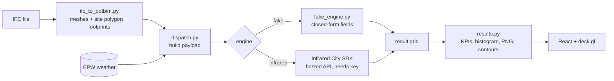

# Architecture

## Modules

| File | Role |
|---|---|
| `backend/main.py` | FastAPI routes |
| `backend/catalog.py` | The 8 analyses and their parameters. The frontend mirrors this in `frontend/src/catalog/analyses.ts` |
| `backend/ifc_to_dotbim.py` | IFC to meshes, site polygon, per-storey footprints |
| `backend/weather.py` | EPW library, header parsing, month/day/hour filtering |
| `backend/dispatch.py` | Parameters to SDK payloads; `run()` is the only network call |
| `backend/fake_engine.py` | Offline stand-in, same result shape as the real engine |
| `backend/results.py` | Grid to KPIs, histogram, heatmap PNG |
| `backend/projects.py` | Flat-file project store under `backend/cache/` |
| `backend/demo.py` | Offline demo: runs all 8 analyses and writes PNGs + `summary.json` |

## Engine switch

`MCS_ENGINE=fake|infrared`. Empty means `fake` when `INFRARED_API_KEY` is unset and `infrared` when it is set.
`GET /health` reports the engine and whether a key is configured. Every result carries an `engine` field, and the UI
shows a "synthetic — fake engine" badge when it is `fake`.

## Frontend fallback

If the backend is unreachable, `frontend/src/api.ts` returns deterministic client-side demo data and marks the session
as a mock. This lets the UI be explored with no backend at all.
